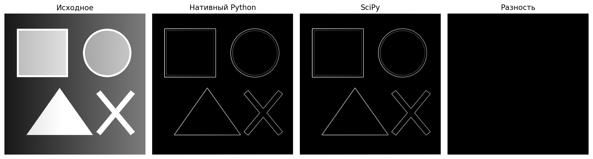
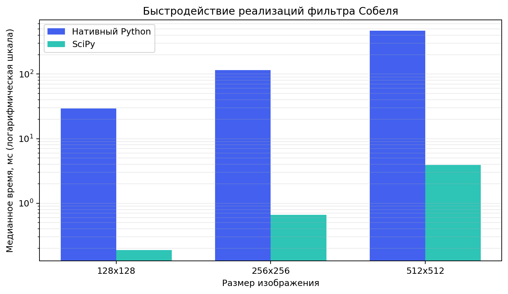

# Лабораторная работа №1. Фильтр Собеля

**Вариант:** 1 — фильтр Собеля  
**Цель работы:** научиться реализовывать и исследовать простой алгоритм обработки изображений.

В проекте один и тот же алгоритм реализован двумя способами:

1. `sobel_native` — свёртка ядрами 3×3 вручную, с явными циклами Python;
2. `sobel_library` — свёртка функцией `scipy.ndimage.correlate`.

Обе реализации используют одинаковые ядра, нулевое дополнение границ, формулу модуля градиента и нормализацию. Благодаря этому сравнивается способ вычисления, а не разные варианты алгоритма.



На правой панели разность полностью чёрная: для тестового изображения результаты совпали по каждому пикселю.

## 1. Теоретическая база

Граница на изображении — область резкого изменения яркости. Её можно обнаружить по величине градиента функции яркости `I(x, y)`. Оператор Собеля приближённо вычисляет горизонтальную и вертикальную производные с помощью двух свёрточных ядер:

```text
Gx = -1  0  1      Gy = -1 -2 -1
     -2  0  2            0  0  0
     -1  0  1            1  2  1
```

Для каждого пикселя берётся его окрестность 3×3. Результаты свёртки с ядрами дают компоненты градиента `gx` и `gy`. Итоговая сила границы рассчитывается как евклидова норма:

```text
G = sqrt(gx² + gy²)
```

Если всё изображение имеет нулевой градиент, результат заполняется нулями. На границе изображения в обеих реализациях применяется нулевое дополнение

## 2. Описание разработанной системы

### Архитектура

```text
изображение → перевод в оттенки серого → Sobel X и Sobel Y
                                            ↓
                                  модуль градиента
                                            ↓
                               нормализация → PNG/JPEG
```

Структура проекта:

```text
СКОИЛАБ1/
├── main.py                 # интерфейс командной строки
├── benchmark.py            # воспроизводимое измерение скорости
├── make_figures.py         # построение изображений и графика отчёта
├── requirements.txt
├── src/
│   └── sobel.py            # обе реализации алгоритма
└── results/                # результаты эксперимента
```

`main.py` загружает изображение через Pillow, переводит его в 8-битные оттенки серого, выбирает реализацию по параметру `--method`, измеряет время и сохраняет результат. 

### Нативная реализация

В `sobel_native` свёртка реализована явно. Для каждого пикселя перебираются девять элементов окна 3×3, после чего отдельно вычисляются `gx`, `gy` и их норма.

### Библиотечная реализация

В `sobel_library` те же ядра передаются в `scipy.ndimage.correlate`. Тяжёлый цикл выполняется внутри оптимизированной библиотеки на низком уровне. `numpy.hypot` вычисляет модуль градиента без потери точности промежуточных значений.

## 3. Запуск

Требуется Python 3.10 или новее.

```bash
python3 -m venv .venv
source .venv/bin/activate          # Windows: .venv\Scripts\activate
python -m pip install -r requirements.txt
```

Обработка изображения библиотечной реализацией:

```bash
python main.py input.jpg output_library.png --method library
```

Обработка нативной реализацией:

```bash
python main.py input.jpg output_native.png --method native
```

Повторить эксперимент и построить иллюстрации:

```bash
python benchmark.py --sizes 128 256 512 --repeats 5
python make_figures.py
```

## 4. Результаты работы и тестирования

Эксперимент выполнен на синтетических изображениях, содержащих плавный градиент, геометрические границы и периодическую текстуру. Для каждой комбинации размера и реализации выполнен один прогревочный и пять измеряемых запусков. В таблице приведена медиана пяти измерений; время загрузки и сохранения файла исключено.

| Размер | Пикселей | Нативный Python, мс | SciPy, мс | Ускорение SciPy |
|---:|---:|---:|---:|---:|
| 128×128 | 16 384 | 29,398 | 0,188 | 156,7× |
| 256×256 | 65 536 | 115,150 | 0,662 | 174,1× |
| 512×512 | 262 144 | 467,315 | 3,903 | 119,7× |



При четырёхкратном увеличении числа пикселей время нативной версии выросло приблизительно в четыре раза: `29,398 → 115,150 → 467,315` мс. Это соответствует ожидаемой линейной зависимости от числа пикселей. Библиотечная версия во всех экспериментах быстрее более чем в 100 раз. Причина — интерпретатор Python выполняет внутренние циклы и множество скалярных операций по отдельности, тогда как SciPy исполняет свёртку в скомпилированном коде.

## 5. Выводы

В работе реализован оператор Собеля нативно на Python и средствами SciPy. Одинаковые граничные условия и единая постобработка обеспечили численно совпадающий результат. Эксперимент подтвердил теоретическую сложность `O(H · W)`: время нативной версии растёт пропорционально числу пикселей.

Оптимизированная библиотечная реализация оказалась быстрее в `119,7–174,1` раза и является предпочтительной для прикладного использования. Нативная версия при этом полезна как прозрачная демонстрация всех шагов алгоритма и эталон для проверки. К ограничениям оператора относятся чувствительность к шуму и отсутствие пороговой классификации границ; в практической системе перед Собелем часто применяют сглаживание, а после него — пороговую обработку или более сложный детектор границ.

## 6. Использованные источники

1. Gonzalez R. C., Woods R. E. *Digital Image Processing*. 4th ed. Pearson, 2018.
2. Sobel I. *An Isotropic 3×3 Image Gradient Operator*. 2014. DOI: [10.13140/RG.2.1.1912.4965](https://doi.org/10.13140/RG.2.1.1912.4965).
3. SciPy Developers. [`scipy.ndimage.correlate`](https://docs.scipy.org/doc/scipy/reference/generated/scipy.ndimage.correlate.html).
4. NumPy Developers. [`numpy.hypot`](https://numpy.org/doc/stable/reference/generated/numpy.hypot.html).
5. Pillow Contributors. [`PIL.Image`](https://pillow.readthedocs.io/en/stable/reference/Image.html).

